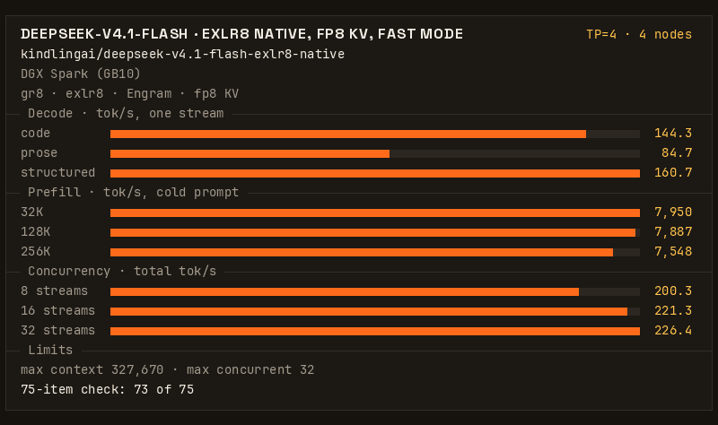

# KindlingAI: DeepSeek-V4.1-Flash EXLR8 on four DGX Sparks

If you are an agent booting this for someone, read [AGENTS.md](AGENTS.md) first, then the Quickstart.

_Join our discord to learn more about KindlingAI and `gr8`: https://discord.gg/8EAvYPV2rE_

[DeepSeek-V4.1-Flash-1017](https://huggingface.co/deepseek-ai/DeepSeek-V4.1-Flash-1017) on four DGX Sparks (GB10,
128 GB each) at TP=4, served by [gr8](https://github.com/kindlingai/gr8) from
[kindlingai/deepseek-v4.1-flash-exlr8-native](https://huggingface.co/kindlingai/deepseek-v4.1-flash-exlr8-native).



## What you need

- Four Sparks on a 200G switch, or cabled in a ring (see Clustering).
- Docker and the NVIDIA container toolkit on each box (both come with DGX OS).
- 510.6 GB of free disk on each box: every box holds the whole release.
- TCP ports 7340 and 7341 open between the boxes.
- No other model running on any box.
- Proactive memory compaction off on each box, once, as root (it holds across reboots):

  ```bash
  echo 'vm.compaction_proactiveness = 0' > /etc/sysctl.d/90-gr8-no-proactive-compaction.conf
  sysctl -w vm.compaction_proactiveness=0
  ```

## Clustering

Give each box one address per PCIe root. The Spark's ConnectX card shows each physical port twice, once on each PCIe
root, and the engines use both. For a cable from the first port to the switch, with netplan:

```yaml
# /etc/netplan/60-connectx.yaml on the first box. On box N: 10.0.0.N and 10.0.1.N.
network:
  version: 2
  ethernets:
    enp1s0f0np0:        # the first port on PCIe root 1
      addresses: [10.0.0.1/24]
      mtu: 9000
    enP2p1s0f0np0:      # the same port on PCIe root 2
      addresses: [10.0.1.1/24]
      mtu: 9000
```

Then run `sudo netplan apply` on each box. If each box's ConnectX port already has an address on each PCIe root, with
MTU 9000, skip this step and put those addresses in `IPS` and `IPS2`.

Four boxes cabled in a ring without a switch also work, with `SHAPE=ring` and without `IPS` and `IPS2`. Cable each
box's f0 port to the next box's f1 port, and list `PEERS` in that cable order
([gr8/docs/DEPLOY.md](https://github.com/kindlingai/gr8/blob/4ed9e7bed53d6ed23ba1c4a32c993ccc3850af96/docs/DEPLOY.md#how-the-boxes-find-each-other)).

With [`mentat`](https://github.com/kindlingai/mentat) running on each box, the recipe finds the other boxes and their
ConnectX addresses by itself. On each box:

```bash
docker run -d --name mentat --network host --restart unless-stopped ghcr.io/kindlingai/mentat:0.27.0
```

What to set, by how the four boxes are joined:

| your boxes | set | leave out |
|---|---|---|
| on a switch, with `mentat` | `MENTAT=1` | `PEERS`, `IPS`, `IPS2` |
| on a switch, without `mentat` | `PEERS` (10G LAN addresses, head first), `IPS`, `IPS2` | |
| in a ring, without a switch | `PEERS` in cable order, `SHAPE=ring` | `IPS`, `IPS2` |

## Quickstart

First, fetch the release on every box. Each box needs all 604 files (510.6 GB). The fetch resumes where it left off
if you run it again, checks every file against the hash Hugging Face lists for it, and fetches a wrong file again:

```bash
docker run --rm --read-only -v ds41-release:/var/lib/gr8/release \
  ghcr.io/kindlingai/deepseek-v4.1-flash-exlr8-4x-spark:latest fetch
```

The download is slow, and four boxes fetching at once share the bandwidth. It is faster to fetch on one box, then copy
the whole `ds41-release` volume, the release and the `.fetch-*` record beside it, to the other three over the ConnectX
ports.

To copy, first run `docker volume create ds41-release` on each of the other three. Then, on the box that fetched, run
the commands below as root. Root on this box must be able to ssh to root on the other three. The addresses are boxes
2 to 4's ConnectX addresses on PCIe root 1 in the netplan example above (their `IPS` values): use yours. The copy runs
8 `rsync` streams to each box at once, and prints a `FAILED` line for each stream that fails:

```bash
V=$(docker volume inspect ds41-release --format '{{ .Mountpoint }}') && cd "$V" &&
  find . -type f -printf '%P\n' > /tmp/ds41-files && split -n r/8 -d /tmp/ds41-files /tmp/ds41-part. &&
  for box in 10.0.0.2 10.0.0.3 10.0.0.4; do
    for part in /tmp/ds41-part.*; do
      ( rsync -a -W --files-from="$part" "$V/" "root@$box:$V/" || echo "FAILED: $box $part" ) &
    done
  done; wait
for box in 10.0.0.2 10.0.0.3 10.0.0.4; do ssh "root@$box" du -sb "$V"; done   # each: at least 510597801105 bytes
```

A copy is whole when no `FAILED` line printed and its volume holds at least 510597801105 bytes. Then run the fetch on
each of the other three: it hashes every file and fetches only the wrong ones.

Then run the published image on all four boxes with the same settings. Without `mentat`, replace `<head>`, `<box2>`,
`<box3>` and `<box4>` with the four boxes' 10G LAN addresses, the same list on every box. The head is the first box in
`PEERS`: it serves the API on port 8100. `IPS` and `IPS2` are the ConnectX addresses from the netplan example above:
use yours.

```bash
docker run -d --name ds41-4x-spark --gpus all --network host --pid host --device /dev/infiniband \
  --ulimit memlock=-1 --ulimit core=0 --cap-drop ALL --cap-add IPC_LOCK \
  --security-opt no-new-privileges --read-only --tmpfs /tmp:size=1g,mode=1777 --init --oom-score-adj 1000 \
  -e PEERS=<head>,<box2>,<box3>,<box4> \
  -e IPS=10.0.0.1,10.0.0.2,10.0.0.3,10.0.0.4 -e IPS2=10.0.1.1,10.0.1.2,10.0.1.3,10.0.1.4 \
  -v ds41-release:/var/lib/gr8/release -v ds41-home:/var/lib/gr8/home \
  ghcr.io/kindlingai/deepseek-v4.1-flash-exlr8-4x-spark:latest
docker logs -f ds41-4x-spark     # on the head: ready at "serving: http://..."
```

With `mentat` running, replace the `PEERS`, `IPS` and `IPS2` settings with `-e MENTAT=1`. The head is then the box
with the lowest address. A container stops at once, and says why, if the release on its box is not whole. The boxes
wait for each other for 10 minutes, so start all four within that time. Expect about 2 minutes to ready.

The head serves an OpenAI-compatible API on port 8100. The model's name is `deepseek-v4.1-flash`:

```bash
curl -s localhost:8100/v1/chat/completions -H 'Content-Type: application/json' -d '{
  "model": "deepseek-v4.1-flash",
  "messages": [{"role": "user", "content": "Write a haiku about a small computer."}],
  "max_tokens": 4096
}'
```

A request that does not set a reasoning effort runs at effort `low`.

```bash
docker exec ds41-4x-spark gr8 ds41 smoke   # on the head: checks the API, tool calls included
docker stop ds41-4x-spark && docker rm ds41-4x-spark   # on every box
```

`:latest` follows `main`. Each commit is also published as `sha-<commit>`, and each tag under its name.

After you update the image, run the fetch once more on every box: it checks every file and downloads only what is
wrong or missing. If the fetch names a file that does not match and stops, `fetch --force` deletes that file and
fetches it again.

## Run it with compose

`compose.yaml` runs the same image with the same settings and reads `PEERS` and the knobs from `.env`. It uses the
same `ds41-release` volume as the commands above. On every box:

```bash
git clone --recurse-submodules https://github.com/kindlingai/deepseek-v4.1-flash-exlr8-4x-spark
cd deepseek-v4.1-flash-exlr8-4x-spark
cp .env.example .env          # set PEERS, IPS and IPS2: the same file on every box
docker compose run --rm gr8 fetch
docker compose up -d
docker compose logs -f
```

Fetch first: compose restarts a container that stops with an error, so without the whole release it starts and stops
again until the fetch is done.

`docker compose up -d --build` builds the image on the box instead.

## Knobs

Set these in `.env` next to `compose.yaml` (see `.env.example`), or with `docker run -e`, the same on every box:

| knob | default | |
|---|---|---|
| `PEERS` | none | The four boxes' 10G LAN addresses, head first. Required unless `MENTAT=1`. |
| `IPS`, `IPS2` | none | Each box's ConnectX address on PCIe root 1 and root 2, in `PEERS` order. |
| `SHAPE` | unset (a switch) | `ring`: four boxes cabled in a ring, without `IPS` and `IPS2`. |
| `TUNE` | `speed` | What to prioritize, see below. `EXACT=1`, the older name, is now `TUNE=quality`. |
| `CAP` | `327680`; `1048576` with `TUNE=context`; `262144` with `TUNE=quality` | The longest chat in tokens, prompt and reply together. Every chat slot gets this much KV at boot. |
| `SESS` | `32`; `16` with `TUNE=context`; `5` with `TUNE=quality` | Chats at once, 1 to 32. A chat that arrives when every slot is busy waits. |
| `MENTAT` | `0` | `1` finds the other boxes and the ConnectX addresses through the host's `mentat` daemon, and registers the API in group `GROUP` (`gr8-ds41-4x`). |
| `RELEASE` | a fixed commit | The release to fetch (`https://huggingface.co/<org>/<repo>@<commit>`). The fetch replaces only the files that differ. |
| `EXTRA_ENV` | none | Engine settings as `NAME=value` pairs separated by spaces (`EXTRA_ENV="A=1 B=2"`). They come after the recipe's own. |

[gr8/KNOBS.md](https://github.com/kindlingai/gr8/blob/4ed9e7bed53d6ed23ba1c4a32c993ccc3850af96/KNOBS.md) lists the
other `gr8` options, which you can also set in `.env`. Some engine settings for `EXTRA_ENV`:

- `GR8_DS_PF_LANES=1` frees about 5 GiB of host memory per Spark, and reads prompts more slowly.
- `GR8_DS_CACHE_MIB` sets the in-memory prefix cache on each box: 4,096 MiB by default, 2,048 with `TUNE=context`. A
  restart empties it.
- `GR8_DS_MHC_Y_MXFP8=1` needs `GR8_DS_MHC_ROW_SHARD=1`. `TUNE=speed` sets both, so to turn them off, set both:
  `EXTRA_ENV="GR8_DS_MHC_ROW_SHARD=0 GR8_DS_MHC_Y_MXFP8=0"`.

## Pick what to prioritize

`TUNE` picks one of three settings (`knobs.sh`). A `CAP` or `SESS` you set yourself keeps your value.

| `TUNE` | what you get |
|---|---|
| `speed` (default) | Fast mode: faster, but replies are not bit-identical to the exact model's. 32 chats at once, each up to 327,670 tokens. |
| `context` | Fast mode with one chat of up to 1,048,566 tokens, 16 chats at once. |
| `quality` | The exact model's output. 5 chats at once, each up to 262,134 tokens. |

## Switch between this and GLM-5.3 on the same four boxes

To run this recipe and [gr8's GLM-5.3](https://github.com/kindlingai/gr8/blob/main/docs/GLM-5.3.md) at TP=4 on the same
four boxes, one model at a time, two settings make the switch fast:

- `GR8_GEN_CACHE` in both models' `EXTRA_ENV` (`.env.example`): the loader keeps the tensors it computes at load on the
  SSD and reads them back at the next boot of the same image. The first boot of an image writes them.
- In gr8's `docker/.env` for GLM, `KV_STORE=ssd:<dir>,size=200G,persist=on,keep=sessions` with `GR8_STOP_GRACE=150s`:
  at the stop, GLM writes its open chats to the SSD, and the next boot reads them back.

GLM to DeepSeek, on every box (GLM from gr8's `docker/` directory, this recipe from its own):

```bash
(cd gr8/docker && docker compose down) && docker compose up -d
```

DeepSeek to GLM, on every box:

```bash
docker compose down && (cd gr8/docker && docker compose up -d)
```

## Run another model

A box runs one model at a time. To switch, stop and remove this recipe's container on every box:

```bash
docker stop ds41-4x-spark && docker rm ds41-4x-spark   # compose: docker compose down
```

The release stays in the `ds41-release` volume, so this recipe starts again later without a new fetch. To free its
510.6 GB, remove the volumes on every box:

```bash
docker volume rm ds41-release ds41-home
```

[gr8's Recipes](https://github.com/kindlingai/gr8#recipes) lists the other models and the number of boxes each one
needs.

## Help

Ask on Discord (https://discord.gg/8EAvYPV2rE) or open an issue in this repo
(https://github.com/kindlingai/deepseek-v4.1-flash-exlr8-4x-spark/issues). Include the command you ran and the end of
`docker logs ds41-4x-spark`. [AGENTS.md](AGENTS.md#5-when-a-step-fails) lists the errors we know and what to do for
each. Remove addresses and hostnames before you post.
